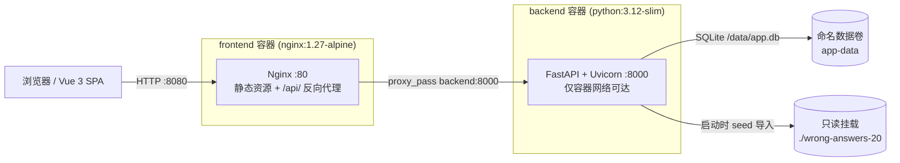

# 错题整理与个人笔记

一个面向学生的错题复习系统：学生登录后只能看到**属于自己的**失分作答记录，可以在课程 / 知识点 / 题干关键词三个维度筛选，查看原题干、原始作答与历史批改反馈，并填写**自己的**错因与复习笔记。

- 后台数据（题干、原始作答、评分、批改反馈）**只读**，绝不会被学生的笔记覆盖。
- 学生笔记是独立的可编辑数据，支持保存、清空，并在容器重建后依然保留。

---

## 1. 快速开始（Docker 一键启动）

### 前置要求

- Docker Desktop（或 Docker Engine + Compose v2）

### 启动

```bash
# 在仓库根目录执行
docker compose up --build
```

该命令会构建前后端两个镜像并启动整个栈；首次构建需要拉取基础镜像与依赖，耗时较长。

常用变体：

```bash
docker compose up --build -d      # 后台启动
docker compose up -d --wait       # 后台启动并阻塞到健康检查通过
docker compose down               # 停止并删除容器（保留数据卷）
docker compose down -v            # ⚠️ 连同数据卷一起删除，会清空所有笔记
docker compose logs -f backend    # 查看后端日志
```

### 访问地址

| 服务 | 地址 | 说明 |
|---|---|---|
| 前端（唯一对外入口） | <http://localhost:8080> | Nginx 托管静态资源，并把 `/api/` 反向代理到后端 |
| 后端 API 文档 | — | 后端 `8000` 端口只 `expose`，不映射到宿主机，仅容器网络内可达 |

端口可通过环境变量覆盖：

```bash
cp .env.example .env    # 然后修改 APP_PORT=8080
```

### 启动自检

```bash
curl http://localhost:8080/api/health
# {"status":"ok","version":"0.1.0"}
```

`docker compose ps` 中 `backend` 应显示 `(healthy)`；前端容器 `depends_on` 后端的健康检查，后端未就绪时前端不会启动。

---

## 2. 测试账号

数据包共 13 个匿名学生账号，**统一密码**如下：

| 登录名 | 密码 | 可见记录 |
|---|---|---|
| `student_001` | `ExamOnly_2026!` | `wrong_001` ~ `wrong_005`（5 条） |
| `student_002` | `ExamOnly_2026!` | `wrong_006`（1 条） |
| `student_003` | `ExamOnly_2026!` | `wrong_007`（1 条） |
| `student_004` | `ExamOnly_2026!` | `wrong_008`, `wrong_009`（2 条） |
| `student_005` | `ExamOnly_2026!` | `wrong_010`（1 条，**无评语**） |
| `student_006` | `ExamOnly_2026!` | `wrong_011`, `wrong_018`（2 条） |
| `student_007` | `ExamOnly_2026!` | `wrong_012`, `wrong_020`（2 条） |
| `student_008` | `ExamOnly_2026!` | `wrong_013`（1 条） |
| `student_009` | `ExamOnly_2026!` | `wrong_014`（1 条） |
| `student_010` | `ExamOnly_2026!` | `wrong_015`（1 条） |
| `student_011` | `ExamOnly_2026!` | `wrong_016`（1 条） |
| `student_012` | `ExamOnly_2026!` | `wrong_017`（1 条） |
| `student_013` | `ExamOnly_2026!` | `wrong_019`（1 条） |

> 账号来源为数据包中每个学生的 `testPassword` 字段，**仅供本地验收使用**，不是生产密码。
> 权限完全由后端会话（HttpOnly Cookie `wa_session`）决定，客户端提交的任何 `studentId` 都不会被采信。

数据概览：20 条失分作答、6 个课程班级、7 份作业、13 名学生；题型 `CALCULATION` 16 条 + `SINGLE_CHOICE` 4 条。

---

## 3. 架构设计



### 前端

- **Vue 3 + TypeScript + Vite**，`vue-router` 管理路由。
- **筛选状态全部存放在 URL query**（`courseId` / `knowledgePoint` / `keyword` / `recordId`），URL 是筛选状态的唯一真源，因此刷新、前进/后退、从详情返回都不会丢失筛选。
- Nginx 负责两件事：托管构建产物，以及把 `/api/` 同源代理到后端容器。**前端与 API 同源**，因此会话 Cookie 不需要任何 CORS 例外。
- 单页应用路由回落到 `index.html`（`try_files $uri $uri/ /index.html`），刷新子路由不会 404。

### 后端

- **FastAPI + SQLAlchemy 2.0 + Pydantic v2**，领域异常统一由异常处理器转换成 `{"detail": ..., "code": ...}` JSON。
- 会话使用服务端会话表 + HttpOnly Cookie（`samesite=lax`，`SESSION_TTL_HOURS` 默认 48 小时）。
- 所有查询都先按当前登录学生过滤，**横向越权返回 403 而不是 404**，以免把「存在但不属于你」和「不存在」混为一谈。

### 数据库与持久化

- SQLite 单文件数据库，位于容器内 `/data/app.db`。
- `/data` 挂载到 **命名数据卷 `app-data`**（完整名称通常是 `<compose 项目名>_app-data`，本项目下为 `exam-project_app-data`）。
- 数据集目录 `./wrong-answers-20` 以**只读**方式挂载到 `/app/dataset`，仓库中不会出现第二份数据集副本。

查看数据卷实际位置：

```bash
docker volume ls | grep app-data
docker volume inspect exam-project_app-data
```

`docker compose down` **不会**删除命名数据卷，因此笔记在容器重建后依然存在；只有显式执行 `docker compose down -v` 才会连同数据一起清空。

### 启动时的数据初始化（seed）

容器每次启动都会执行 `backend/docker-entrypoint.sh` → `python -m app.seed`：

1. 校验数据包 `SHA256SUMS`（不匹配则中止，退出码 2）。
2. 按**主键 upsert** 导入 students / courses / assignments / records。
3. **完全不触碰 `notes` 表。**

因此重复执行不会产生重复数据，也**绝不会覆盖、抹除或回滚**学生已保存或已清空的笔记。学生笔记存储在独立的 `notes` 表（`records.id` 一对一），与只读的来源数据物理隔离。

---

## 4. 字段对应关系与渲染策略

### 字段映射

数据包使用 camelCase，后端 DB 使用 snake_case，API 响应统一转回 camelCase（Pydantic `CamelModel`）。

| 数据包 / API 字段 | DB 列 | 类型 | 界面处理 |
|---|---|---|---|
| `id` | `id` | string | 记录标题、列表条目 |
| `studentId` | `student_id` | string | **决定可访问者**，不接受客户端提交 |
| `courseId` / `courseName` | `course_id` + 关联 | string | 列表与详情元信息 |
| `assignmentId` / `assignmentTitle` | `assignment_id` + 关联 | string | 详情元信息 |
| `questionId` | `question_id` | string | 详情元信息（同一道题可能有多个学生的作答，**不据此合并**） |
| `questionType` | `question_type` | enum | `CALCULATION`→计算题，`SINGLE_CHOICE`→单选题 |
| `questionText` | `question_text` | string | 题干，按公式渲染 |
| `questionFormat` | `question_format` | enum | 本数据包为 `markdown_latex` |
| `originalAnswer` / `answerFormat` | `original_answer` / `answer_format` | string / enum | `html` → DOMPurify 清洗后渲染；`text_latex` → 公式渲染 |
| `score` / `maxScore` | `score` / `max_score` | number | 保留小数原样显示，不做整数四舍五入 |
| `feedback` | `feedback` | string \| **null** | 有值显示原文；**null / 空 显示「暂无评语」** |
| `gradingSource` | `grading_source` | enum | `AI`→AI 评分，`TEACHER`→教师评分 |
| `knowledgePoints` | `knowledge_points` | string[] | 非空渲染为标签；**空数组显示「未标注」** |
| `initialNote` | `initial_note` | string | 来源初始笔记（本包均为空），**只读**，不参与编辑 |
| （用户数据） | `notes.cause` / `notes.content` | string | 学生填写的错因与复习笔记，**可编辑** |

### 原始答案渲染

`originalAnswer` 按 `answerFormat` 分流：

- **`html`**（16 条）：先经 **DOMPurify** 清洗，再以 `v-html` 渲染。保留段落、列表、下标、上标等结构；脚本、事件属性（如 `onerror`）、`javascript:` 链接、`<iframe>`/`<object>`/`<embed>`/`<form>` 等一律移除。原始作答属于不可信输入，因此**不信任来源数据**。
- **`text_latex`**（4 条）：走公式渲染管线。

题干（`questionText`）与文本作答走同一条公式管线：先把**非公式部分做 HTML 转义**，再交给 KaTeX，因此原始文本里的标签不会被执行。

### 公式异常降级策略（不会白屏）

`frontend/src/utils/math.ts` 双保险：

1. `katex.renderToString(..., { throwOnError: false, strict: 'ignore', trust: false })`
   —— 语法错误时 KaTeX **不抛异常**，而是把原始 TeX 以红色文本 + `title` 提示的形式渲染出来，读者仍能看到原始可读内容。
2. 外层 `try / catch` —— 极端输入若仍然抛错，退回 `<span class="math-fallback">`，内容是**转义后的原文**（保留 `$...$` 包裹），绝不丢整段内容、也不擅自修改数学含义。

无论哪条路径，都只输出转义后的字符串，因此不会导致 Vue 渲染崩溃或白屏。

---

## 5. 关键场景验证（实际测试结果）

以下结果均为在本仓库 `docker compose up --build` 后实测所得。

### 场景 1：筛选 → 详情 → 编辑保存笔记 → 返回，筛选状态 100% 保留

**步骤**

1. 以 `student_001 / ExamOnly_2026!` 登录。
2. 课程选择「线性代数 · 示例班 001」，题干关键词输入 `四阶`，回车。
3. 点击结果中的 `wrong_001` 进入详情。
4. 填写错因与复习笔记，点击「保存笔记」。
5. 点击「返回列表」。

**实际结果**

| 检查点 | 结果 |
|---|---|
| 筛选后 URL | `/records?courseId=course_001&keyword=%E5%9B%9B%E9%98%B6`，列表收敛为 **共 1 条错题** |
| 进入详情后 URL | `...&recordId=wrong_001`（筛选参数被完整带过去） |
| 保存笔记 | 提示「笔记已保存」，列表条目出现「已记录笔记」标记 |
| 返回后 URL | `/records?courseId=course_001&keyword=%E5%9B%9B%E9%98%B6`（`recordId` 被移除，筛选参数保留） |
| 返回后控件状态 | 课程下拉 = `course_001`（显示「线性代数 · 示例班 001」），关键词输入框 = `四阶`，计数 = **共 1 条错题** |

✅ **通过**：筛选状态与关键词输入完全保留（因为筛选状态存放在 URL，由路由驱动，而非组件内部状态）。

> 关键词输入做了 400ms 去抖；使用 `router.replace` 更新，因此连续输入不会污染浏览器历史。回车或失焦会立即提交。

### 场景 2：跨账号访问他人错题 / 修改接口 → 403 越权拦截

**步骤**：分别以匿名、`student_002`（拥有 `wrong_006`）身份请求 `student_001` 的记录与笔记接口。

**实际结果**

| 请求 | 结果 |
|---|---|
| 匿名 `GET /api/records` | **401** 未登录或会话已过期 |
| 匿名 `GET /api/records/wrong_001` | **401** 未登录或会话已过期 |
| `student_002` `GET /api/records/wrong_001` | **403** 无权访问他人的作答记录 |
| `student_002` `PUT /api/records/wrong_001/note` | **403** 无权访问他人的作答记录 |
| `student_002` `DELETE /api/records/wrong_001/note` | **403** 无权访问他人的作答记录 |
| `student_002` `GET /api/records/does_not_exist` | **404** 作答记录不存在 |
| `student_002` `GET /api/records/wrong_006`（自己的） | **200** |
| `student_001` `GET /api/records/wrong_001`（自己的） | **200** |

攻击后复查：`wrong_001` 的笔记仍为 `cause='' content=''`（**未被篡改**）；`student_002` 的列表只返回 `wrong_006`。

✅ **通过**：读、写、删除三条路径都被拦截；403 与 404 语义区分明确。

> 实现要点：`save_note()` / `clear_note()` 都先调用 `get_record_for_student()` 做归属校验，因此**修改接口同样受保护**，不只是读取接口。

### 场景 3：无评语 / 未标注占位，以及公式异常降级

**3a. 占位文案**

| 场景 | 记录 | 实际显示 |
|---|---|---|
| 来源无公开评语 | `wrong_010`（`student_005`） | 历史批改反馈区域显示 **「暂无评语」**（不是 `null` / `undefined` / 「无」，也没有编造内容） |
| 来源未标注知识点 | `wrong_001`（`student_001`）等 `wrong_001`~`wrong_007` | 知识点区域显示 **「未标注」** |
| 来源有知识点 | `wrong_010` | 渲染为 5 个标签：矩阵相似的性质 / 齐次线性方程组的基础解系求解 / 施密特正交化方法 / 特征多项式的计算 / 向量的单位化 |

> 断言依据：`RecordDetail.vue` 中 `v-if="record.feedback"` → 否则「暂无评语」；`v-if="record.knowledgePoints.length === 0"` → 「未标注」。

**3b. 公式异常降级**

为验证健壮性，临时注入了一条含**故意写坏的 LaTeX**（`$\frac{1}{$` 括号不闭合、`$\begin{aligned} x$` 环境未闭合）的记录：

| 检查点 | 结果 |
|---|---|
| 页面是否白屏 / 崩溃 | **否**，页面完整渲染，其余区块（评分、作答、笔记编辑器）均正常 |
| 公式区域渲染结果 | 生成 2 个 `<span class="katex-error" style="color:#cc0000" title="ParseError: ...">`，内容为**原始可读文本** `\frac{1}{`、`\begin{aligned}` |
| 是否丢失整段内容 | **否**，前后中文文本正常显示 |

**3c. 原始 HTML 作答的 XSS 防护**

同一条临时记录的 `originalAnswer`（`answerFormat = html`）中植入了 `<script>window.__xss=1</script>`、``、`<a href="javascript:window.__xss=3">`：

| 检查点 | 结果 |
|---|---|
| `window.__xss` 是否被写入 | **未被写入**（始终为 `undefined`） |
| `.safe-html` 内残留 `<script>` | **0 个** |
| 残留 `img[onerror]` | **0 个** |
| 残留 `a[href^="javascript"]` | **0 个** |
| 正常内容是否保留 | ✅ `<p>` 文本、`<sub>` 下标均正常渲染 |

✅ **通过**：三处子场景全部符合预期。测试记录已在验证后删除，数据库恢复为 20 条。

### 场景 4（附加）：数据持久化与 seed 幂等性

| 步骤 | 结果 |
|---|---|
| 为 `student_001` 保存笔记 → 清空 → `docker compose down`（保留卷） → `docker compose up -d` → 重新登录 | 笔记**仍为空**（清空状态被保留），「上次保存」时间戳未被重置 |
| 保存一条**非空**笔记 → `down` → `up -d` | 笔记内容**完整保留**（`cause='persist-check' content='survive-restart'`） |
| 重启后表计数 | students=13, courses=6, assignments=7, records=20, notes=1 —— **seed 幂等，无重复数据** |
| 会话是否存活 | 容器重建后原 Cookie 依然有效（会话存于数据库） |

✅ **通过**：seed 从不触碰 `notes` 表，用户数据在容器重建后依然保留。

### 场景 5（附加）：后端自动化测试

```bash
cd backend && pytest
# 28 passed
```

覆盖数据包校验与导入幂等性、鉴权与会话、筛选结果与 `expected-filters.json` 的一致性、笔记保存/清空/归属校验等。

---

## 6. 关键技术取舍与已知限制

### 取舍

| 决策 | 理由 |
|---|---|
| **筛选状态放 URL 而非 Pinia/组件状态** | 免费获得刷新保持、前进/后退、可分享链接；「返回后筛选保留」不需要任何额外代码 |
| **前后端同源（Nginx 代理 `/api/`）** | 会话 Cookie 不需要 CORS 例外，`SameSite=Lax` 即可生效，也避免了带凭据跨域的安全坑 |
| **服务端会话表 + HttpOnly Cookie** | 可服务端撤销（登出即失效），Cookie 不可被 JS 读取 |
| **越权返回 403、不存在返回 404** | 语义清晰；但这也意味着**知道记录 ID 就能区分「他人所有」与「不存在」**（见下方限制） |
| **SQLite + 命名数据卷** | 单机验收场景下零运维、天然持久化；不适合高并发写入 |
| **KaTeX `throwOnError:false` + 外层 try/catch** | 双层降级，保证任何异常公式都不会导致白屏 |
| **DOMPurify 白名单清洗 + 保留结构标签** | 原始作答必须保留上下标等语义，因此不能简单地全量转义 |

### 已知限制

1. **筛选以整体响应为粒度，未做服务端分页**。数据量为 20 条，前端一次性取回；若记录量级增长到数千条，需要引入分页与索引优化。
2. **知识点的筛选在应用层完成**（`knowledge_points` 是 JSON 列，SQLite 上不便按元素检索），因此「知识点」筛选会在取出该学生的全部记录后再过滤，量大时效率下降。
3. **403 / 404 的区分会泄露「记录是否存在」**。这是本题目明确要求的语义（区分「不属于你」与「不存在」）；如果面向更严格的安全场景，应统一返回 404。
4. **Cookie `Secure` 默认关闭**（`SESSION_COOKIE_SECURE=false`），因为本地以 HTTP 验收。生产部署必须在 HTTPS 下置为 `true`。
5. **`session_ttl_hours` 默认 48 小时**，且没有滑动续期；过期后需重新登录。
6. **无数据库迁移工具**（未引入 Alembic）。表结构变更需要删除数据卷重建（`docker compose down -v`），会丢失已保存笔记。
7. **测试账号密码为明文写在数据包中**，仅供本地验收；生产环境必须改为正式的身份体系。
8. **`initialNote` 字段已被导入但未在界面展示**：本数据包中该字段均为空字符串，界面上展示的是历史批改反馈（`feedback`）与学生自己的笔记两个独立区域。
9. **公式解析使用正则匹配 `$...$` / `$$...$$`**，对公式内部包含 `$`（如货币符号）等极端写法可能出现切分偏差，此时按普通文本降级显示，不会崩溃。

---

## 7. 目录结构

```
.
├── docker-compose.yml          # backend + frontend 两个服务，命名数据卷 app-data
├── .env.example                # APP_PORT 示例
├── backend/
│   ├── Dockerfile              # python:3.12-slim，非 root 运行
│   ├── docker-entrypoint.sh    # 启动前执行 python -m app.seed
│   ├── requirements.txt
│   └── app/
│       ├── main.py             # FastAPI 入口、/api/health、异常处理
│       ├── seed.py             # 数据包校验 + 主键 upsert（不触碰 notes 表）
│       ├── security.py         # 密码哈希与校验
│       ├── api/routes/         # auth.py（登录/登出/me）、records.py（筛选/详情/笔记）
│       ├── core/               # 配置与领域异常
│       ├── db/                 # Base 与 Session
│       ├── models/             # Student / Course / Assignment / Record / Note / AuthSession
│       ├── schemas/            # Pydantic CamelModel 响应体
│       └── services/           # auth / records / notes 业务逻辑（含归属校验）
├── frontend/
│   ├── Dockerfile              # node:22-alpine 构建 → nginx:1.27-alpine 运行
│   ├── nginx.conf              # 静态资源 + /api/ 反向代理 + SPA 回落
│   └── src/
│       ├── api/                # client.ts（fetch 封装）、types.ts（与后端 schema 对应）
│       ├── components/         # FilterSidebar / RecordList / RecordDetail / NoteEditor
│       │                       # MathText（公式）/ SafeHtml（DOMPurify）
│       ├── router/             # 路由定义
│       ├── utils/math.ts       # KaTeX 渲染 + 异常降级
│       ├── utils/format.ts     # 分数/时间/枚举标签/列表摘要
│       └── views/              # LoginView / RecordsView
├── wrong-answers-20/           # 数据包（只读挂载进容器）
└── 03-wrong-answer-supplement/ # 字段字典、逐条索引、期望筛选结果、验收步骤
```

---

## 8. 本地开发（不使用 Docker）

```bash
# 后端
cd backend
pip install -r requirements-dev.txt
python -m app.seed                 # 导入数据（幂等）
uvicorn app.main:app --reload --port 8000

# 前端
cd frontend
npm ci
npm run dev                        # http://localhost:5173，已配置代理到 :8000
```

后端默认使用 `backend/data/app.db`，会自动探测仓库内 `wrong-answers-20/dataset.json`。

运行测试：

```bash
cd backend
pytest
```

完整性校验（只校验 SHA-256，不写库）：

```bash
python -m app.seed --check-sums
```

---

## 9. 验收对照

| 要求 | 实现位置 |
|---|---|
| 无评语显示「暂无评语」 | `frontend/src/components/RecordDetail.vue` |
| 无知识点显示「未标注」 | `frontend/src/components/RecordDetail.vue` |
| 公式异常降级、不崩溃 | `frontend/src/utils/math.ts`（`throwOnError:false` + `try/catch` → `math-fallback`） |
| 原始 HTML 安全渲染 | `frontend/src/components/SafeHtml.vue`（DOMPurify） |
| 筛选状态保持 | `frontend/src/views/RecordsView.vue`（URL query 驱动） |
| seed 不覆盖笔记 | `backend/app/seed.py`（不触碰 `notes` 表）+ `backend/app/models/note.py`（独立表） |
| 跨账号 403 拦截 | `backend/app/services/records.py`、`backend/app/services/notes.py`、`backend/app/core/errors.py` |
| 数据卷持久化 | `docker-compose.yml`（`app-data:/data`） |
